# Birthday Wish for your Friend, Cousin, Sibling, Boyfriend or Girlfriend

An interactive birthday web app that turns a greeting into a small experience: an animated landing page with a live countdown, a seven-question "official Wish", a printable-style certificate, a candle-blowing cake, and a personal letter. Every name, age, date and relationship is configurable through a link, so one deployment can serve any number of celebrations. It works for friends, cousins, brothers, sisters, boyfriends and girlfriends, each with its own wording.

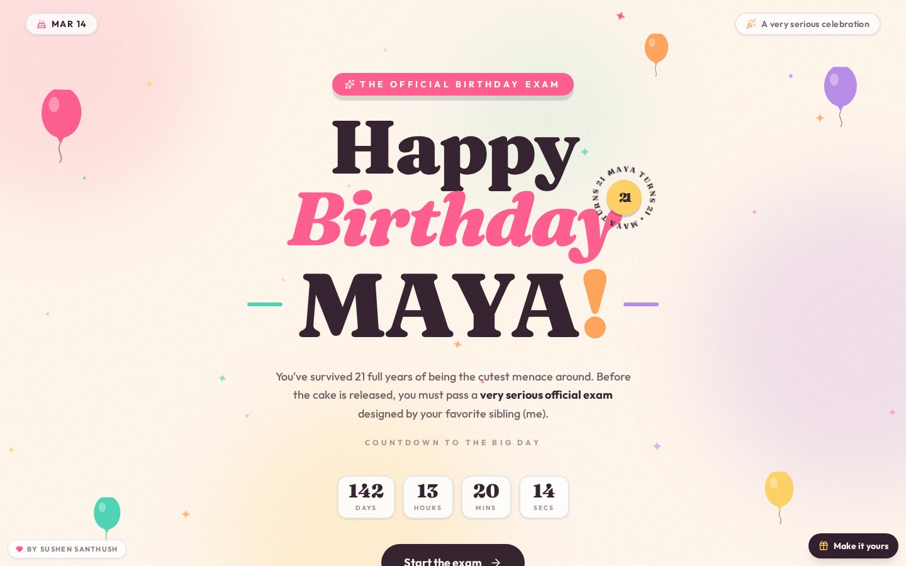

## Table of contents

- [Features](#features)
- [Screenshots](#screenshots)
- [Tech stack](#tech-stack)
- [Getting started](#getting-started)
- [Personalization](#personalization)
- [Customizing the content](#customizing-the-content)
- [Project structure](#project-structure)
- [Scripts](#scripts)
- [Deployment](#deployment)
- [Attribution and license](#attribution-and-license)
- [Author](#author)

## Features

- **Landing page** with a live countdown to the next birthday, floating balloons, a rotating age badge and an animated marquee.
- **Seven-question Wish** with instant feedback, a progress bar, confetti on correct answers and a skip option.
- **Results and certificate** with an animated score count-up and a ticket-style certificate.
- **Interactive finale** where each candle can be blown out individually. Once the last candle is out, the wish animation plays and the personal letter is revealed and scrolled into view.
- **Six relationships.** Brother, sister, cousin, friend, boyfriend and girlfriend, with a dedicated romantic letter for couples.
- **Link-based personalization.** Name, age, birthday, signature and relationship are read from the URL, sanitized and applied across every screen.
- **"Make it yours" dialog** that builds a shareable link without editing any code.
- **Responsive and accessible.** Designed mobile-first, with labelled controls, a keyboard-dismissable dialog and reduced-motion support for confetti.
- **Single-file build.** The production build is one self-contained `index.html`, which makes hosting trivial.

## Screenshots

### Desktop

| Wish question | Results and certificate |
| :---: | :---: |
| 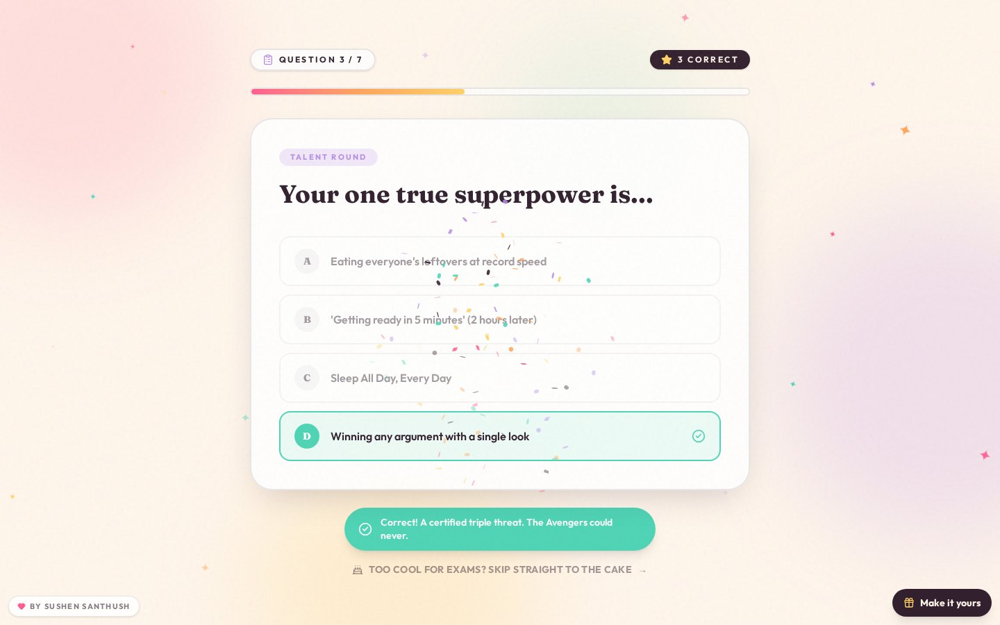 | 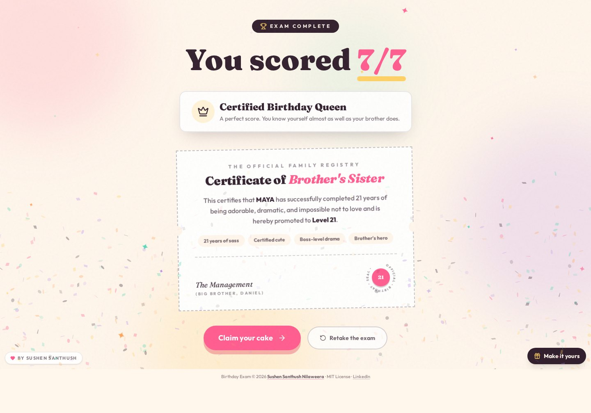 |

| Finale with candles | Personalization dialog |
| :---: | :---: |
| 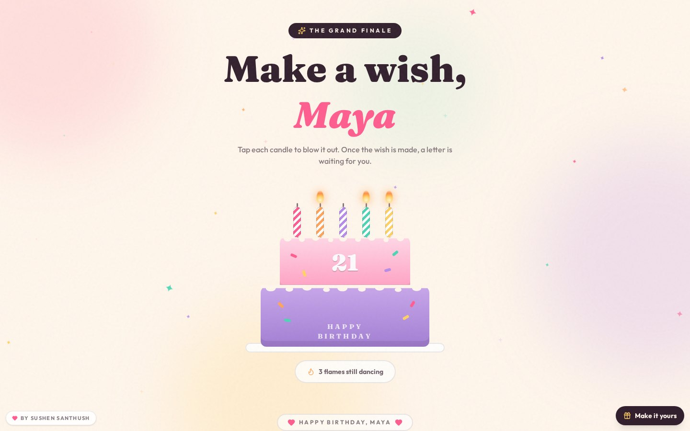 | 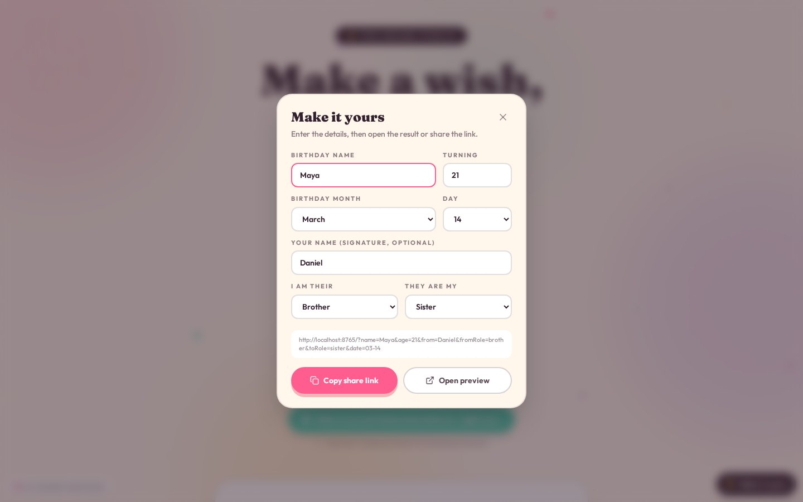 |

<details>
<summary>Finale with the letter revealed after the candles are blown out</summary>

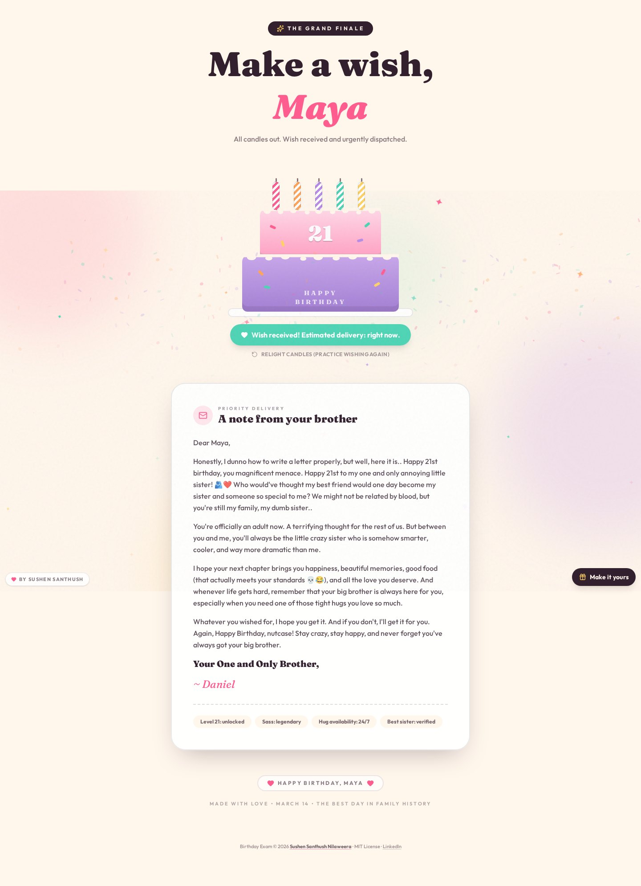

</details>

<details>
<summary>Boyfriend and girlfriend variant</summary>

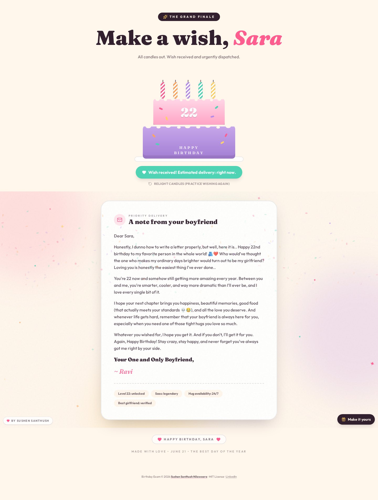

</details>

### Mobile

| Landing | Wish | Results | Finale | Personalize |
| :---: | :---: | :---: | :---: | :---: |
| 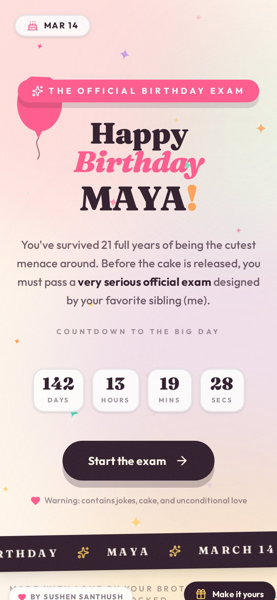 | 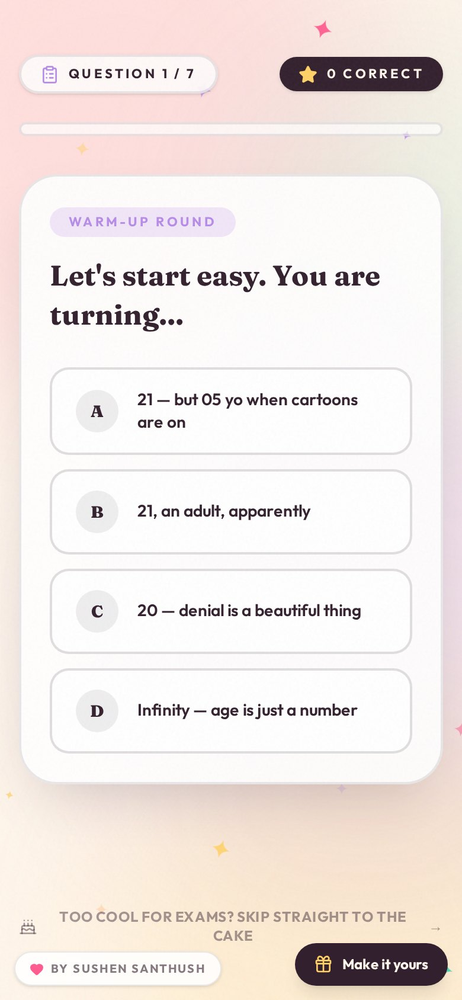 | 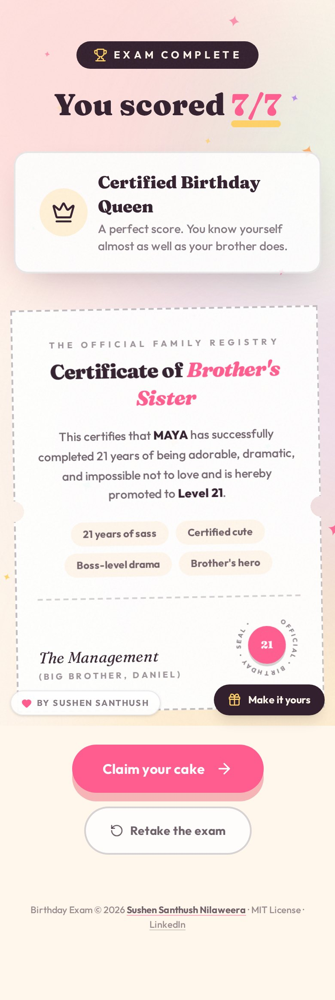 | 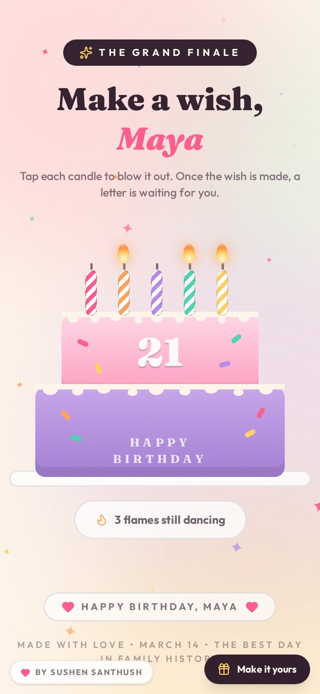 | 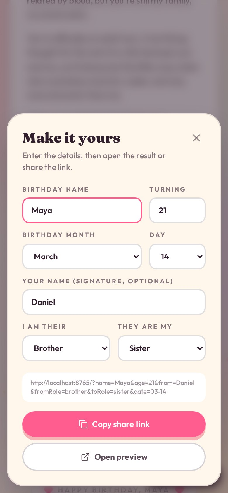 |

## Tech stack

| Area | Technology |
| --- | --- |
| UI | React 19, TypeScript 5 |
| Build | Vite 7, `vite-plugin-singlefile` |
| Styling | Tailwind CSS 4 |
| Animation | Framer Motion, `canvas-confetti` |
| Icons | Lucide React |
| Typography | Fraunces and Outfit (Google Fonts) |

## Getting started

Requirements: Node.js 20 or later.

```bash
git clone https://github.com/sushensanthush/BirthdayWish.git
cd BirthdayWish
npm install
npm run dev
```

The development server prints a local URL. Append personalization parameters to preview a specific celebration, for example:

```
http://localhost:5173/?name=Maya&age=21&from=Daniel&date=03-14
```

## Personalization

All values are optional. Anything omitted falls back to the defaults in `src/config.ts`.

| Parameter | Description | Example | Default |
| --- | --- | --- | --- |
| `name` | Birthday person's name (max 20 characters) | `name=Maya` | `Alex` |
| `age` | Age they are turning (1 to 120) | `age=21` | `20` |
| `date` | Birthday as `MM-DD` | `date=03-14` | `10-19` |
| `from` | Sender's name, used in the letter signature and certificate (max 24 characters) | `from=Daniel` | empty |
| `fromRole` | Sender's relationship: `brother`, `sister`, `cousin`, `friend`, `boyfriend`, `girlfriend` | `fromRole=boyfriend` | `brother` |
| `toRole` | Birthday person's relationship: `brother`, `sister`, `cousin`, `friend`, `boyfriend`, `girlfriend` | `toRole=girlfriend` | `sister` |

Family and friend example:

```
https://your-site.example/?name=Maya&age=21&from=Daniel&date=03-14&fromRole=brother&toRole=sister
```

Boyfriend and girlfriend example:

```
https://your-site.example/?name=Sara&age=22&from=Ravi&date=06-21&fromRole=boyfriend&toRole=girlfriend
```

Romantic roles are always paired. If only one of the two roles is romantic, the other is adjusted automatically (for example, `fromRole=boyfriend` becomes a boyfriend and girlfriend pair), so the letter and wording never mix family and couple language.

The **Make it yours** button in the bottom-right corner of the app generates these links through a form, so nobody needs to write the URL by hand.

Input handling: names are restricted to letters, spaces, apostrophes, periods and hyphens, trimmed and length-limited. Invalid ages, dates and roles fall back to the defaults. Values are rendered as plain text by React and never as HTML.

To hard-code a deployment instead of using links, edit the `DEFAULTS` object in `src/config.ts`.

## Customizing the content

| What | Where |
| --- | --- |
| Wish questions, answers, feedback messages and score titles | `src/data/quiz.ts` |
| The closing letter (family and romantic versions) | `src/data/letter.ts` |
| Colors, fonts and animations | `src/index.css` (Tailwind `@theme` block) |
| Confetti behavior | `src/utils/confetti.ts` |

In `quiz.ts`, an empty `correct` array means every option is accepted, which is how the joke rounds work. Text templates use the helper `T` from `src/config.ts`, for example `` `Your ${T.fromRole} says hello` ``.

## Project structure

```
.
├── docs/screenshots/        README images
├── src/
│   ├── components/
│   │   ├── Backdrop.tsx     Animated background
│   │   ├── Credit.tsx       Attribution badge and footer
│   │   ├── Finale.tsx       Cake, candles and letter
│   │   ├── Hero.tsx         Landing page and countdown
│   │   ├── Personalize.tsx  "Make it yours" dialog
│   │   ├── Quiz.tsx         Wish flow
│   │   └── Results.tsx      Score and certificate
│   ├── data/
│   │   ├── letter.ts        Letter text
│   │   └── quiz.ts          Questions and results
│   ├── utils/               Confetti and class-name helpers
│   ├── config.ts            Personalization and URL parsing
│   ├── credit.ts            Project attribution
│   ├── App.tsx              Screen state machine
│   └── main.tsx             Entry point
├── index.html
├── vite.config.ts
└── .github/workflows/deploy.yml
```

## Scripts

| Command | Description |
| --- | --- |
| `npm run dev` | Start the development server |
| `npm run build` | Type-check and build a single-file bundle into `dist/` |
| `npm run typecheck` | Run the TypeScript compiler without emitting files |
| `npm run preview` | Serve the production build locally |

## Deployment

The build output is a single `dist/index.html`, so any static host works.

- **GitHub Pages:** push to `main`. The included workflow in `.github/workflows/deploy.yml` builds and publishes the site. In the repository settings, set Pages to use **GitHub Actions** as the source.
- **Netlify or Vercel:** import the repository, use `npm run build` as the build command and `dist` as the publish directory.
- **Any static host:** upload `dist/index.html`.

Because personalization lives in the query string, no server configuration is required.

## Attribution and license

This project is released under the [MIT License](LICENSE). You are free to use, modify and share it, including for personal gifts, provided the copyright notice and license stay with the code.

When you fork or redistribute it, please keep the attribution in place:

- the `LICENSE` file,
- the credit badge and footer rendered by `src/components/Credit.tsx` (data in `src/credit.ts`),
- the copyright header in the source files and in `index.html`.

The personalization settings never modify the credit, so changing the recipient or sender is always possible without touching the attribution.

## Author

**Sushen Santhush**
Software Engineering undergraduate, Birmingham City University

- GitHub: [github.com/sushensanthush](https://github.com/sushensanthush)
- LinkedIn: [linkedin.com/in/sushensanthush](https://www.linkedin.com/in/sushensanthush)
